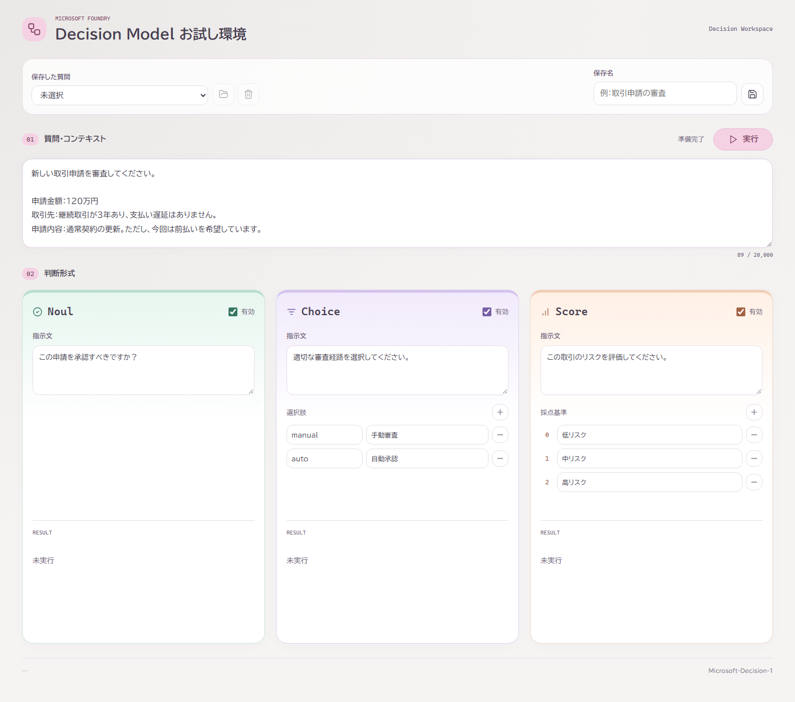
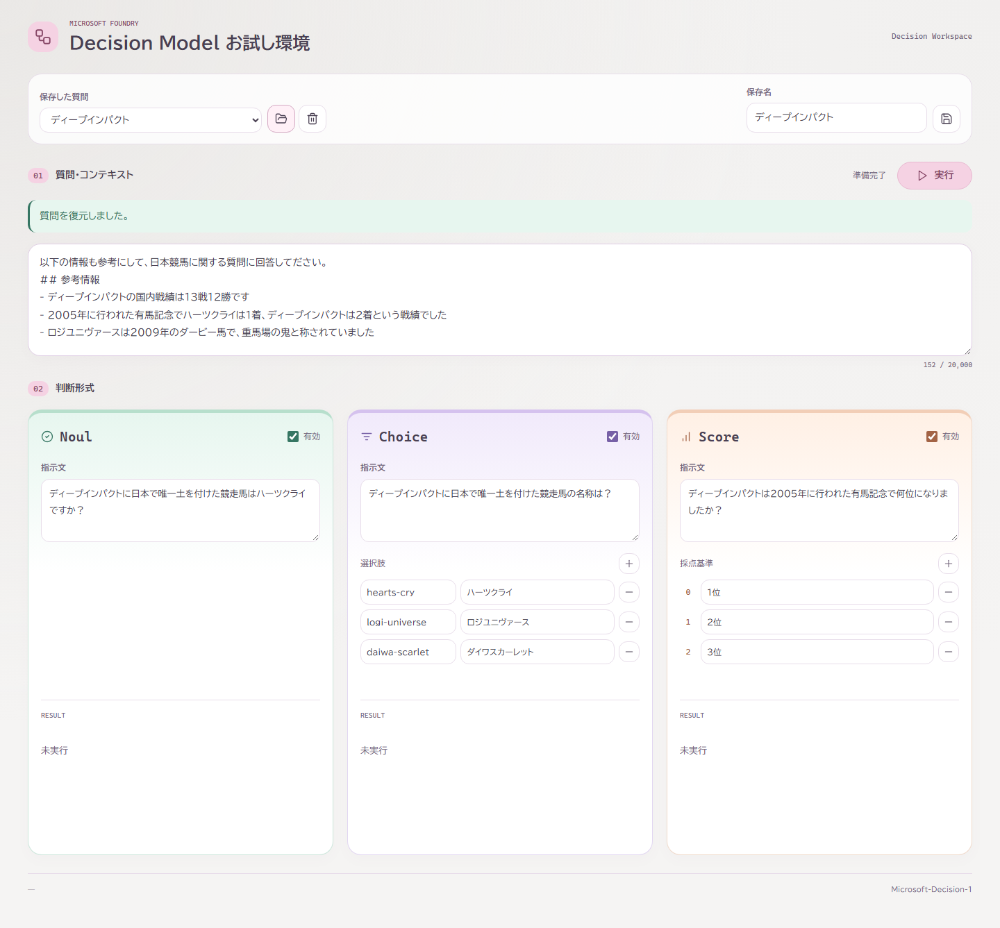
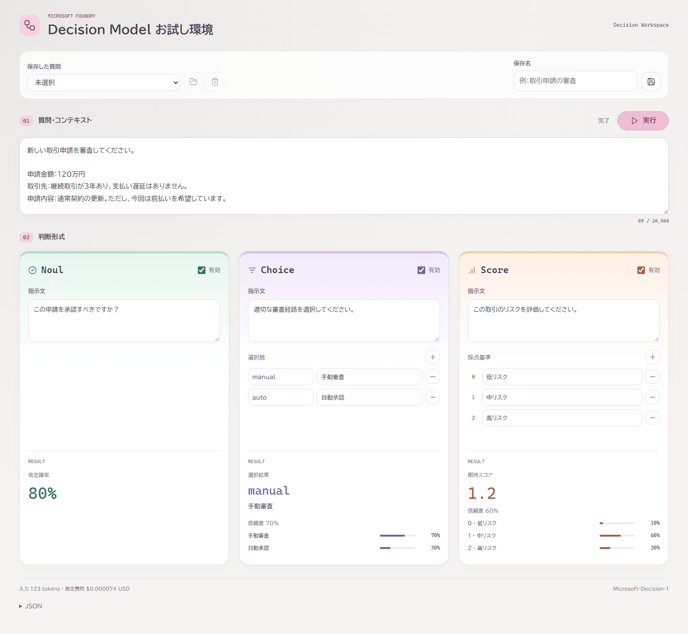
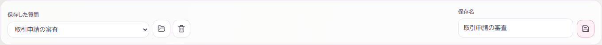

# Decision Model お試し環境 ― 使い方

`Microsoft-Decision-1` に質問し、肯定確率・選択結果・スコアを確認するための操作ガイドです。
文章による自由回答ではなく、目的に合わせた3つの判断形式を使います。

> 本資料の画面はデスクトップ表示で撮影しています。画面幅が狭い場合、各パネルは縦に並びます。
> 結果画面の数値は説明用の模擬応答で、実際のモデルの回答・精度・費用を示すものではありません。

## 1. 利用前の確認

- 管理者から案内された URL をブラウザーで開きます。
- 自分の PC で起動した場合の URL は、通常 `http://127.0.0.1:8000` です。
  起動時にポートを変更した場合は、その番号に読み替えてください。
- 初回の環境構築や接続設定は [README のセットアップ](../README.md#セットアップ) と
  [起動方法](../README.md#起動) を参照してください。
  利用者が画面で API キーを入力する必要はありません。
- **実行すると入力内容がモデルに送信され、費用が発生する場合があります。**
  業務情報・個人情報・機密情報を入力してよいか、事前に確認してください。
- モデルの出力は判断の参考情報です。業務上の最終判断は、人が根拠やルールと照らして確認してください。

画面の表示や質問の保存・復元だけでは、モデルは実行されません。
接続設定が未完了でも画面と保存機能は利用できますが、モデルの実行には管理者による設定が必要です。

## 2. 画面の見方



*図1：初期画面。取引申請の質問例が入力されています。*

| 場所 | 役割 |
| --- | --- |
| 上部「保存した質問」「保存名」 | サンプルや自分で保存した質問を復元・保存・削除します |
| 「01 質問・コンテキスト」 | 判断対象の文章、背景情報、条件などを入力します。3形式で共通の入力です |
| 「実行」とその左の状態表示 | モデルに問い合わせます。状態は「準備完了」「実行中」「完了」「失敗」などで表示されます |
| 「02 判断形式」 | Noul・Choice・Score ごとの指示や基準を設定します |
| 各パネルの「有効」 | その形式を実行するか選びます |
| 各パネル下部「RESULT」 | その形式の結果を表示します。実行前は「未実行」です |
| 画面下部 | 実行後に入力トークン数・推定費用と、展開可能な「JSON」を表示します |

## 3. まず1回試してみる

### 初期の取引申請の例を使う

1. 画面を開き、「質問・コンテキスト」に取引申請の例が入っていることを確認します。
2. Noul・Choice・Score の「有効」にチェックが入っていることを確認します。
3. 各パネルの指示文・選択肢・採点基準を読みます。最初は初期値のまま試せます。
4. 「実行」を押します。
5. 「実行中」が「完了」に変わったら、各パネル下部の結果を確認します。
   結果が見えない場合は下へスクロールしてください。

実行中は二重送信を防ぐため、質問の編集・実行・保存・復元などの操作ができなくなります。
有効な形式はまとめて1回のモデル呼び出しに送信されます。

> 再実行すると新たな呼び出しになります。結果は毎回同じになるとは限りません。
> 通信失敗時の自動再試行はありません。タイムアウト後の再実行でも追加費用が発生する場合があります。

### 保存済みのサンプルを使う

初回アクセス時、ブラウザーの保存領域が未作成の場合は、次の2つが登録されます。

- **ディープインパクト**：参考情報に基づく肯定判断・競走馬の選択・順位の評価を試します。
- **物語文**：長い本文をコンテキストとして使う例です。

1. 上部の「保存した質問」でサンプルを選びます。
2. 一覧の右にある**フォルダーのボタン（選択した質問を復元）**を押します。
3. 「質問を復元しました。」と表示され、本文と各形式の設定が切り替わったことを確認します。
4. 必要に応じて編集し、「実行」を押します。

**一覧で選ぶだけでは入力欄は切り替わりません。復元ボタンを押してください。**
復元すると現在の入力が置き換わるので、残したい内容は先に保存してください。
復元だけではモデルを実行せず、サンプルに回答は付属していません。



*図2：サンプルを復元した状態。結果はまだ「未実行」です。*

すでに保存領域がある場合、空の一覧でもサンプルは追加されません。
サンプルを削除しても、ページの再読み込みでは復活しません。

## 4. 自分の質問を作る

### 4.1 質問・コンテキスト

大きなテキストエリアに、判断に必要な事実・背景・制約を入力します。
例えば、取引の審査なら「金額」「取引実績」「申請内容」「審査ルール」などを記載します。
各形式で何を答えてほしいかは、それぞれの「指示文」に書きます。

```text
新しい取引申請を審査してください。

申請金額：120万円
取引先：継続取引が3年あり、支払い遅延はありません。
申請内容：通常契約の更新。ただし、今回は前払いを希望しています。
```

画像やファイルの添付には対応していません。必要な情報はテキストで入力してください。
会話を継続するチャットではなく、実行ごとに現在の入力で判断します。

### 4.2 利用する形式を選ぶ

各パネル右上の「有効」を切り替えます。**少なくとも1形式を有効にしてください。**
例えば選択肢からの分類だけを試すなら、Choice だけを有効にできます。

無効にした形式の入力は画面内に残りますが、モデルには送信されず、結果欄は「無効」になります。
チェックを戻すと、その形式の入力欄を再び編集できます。

### 4.3 Noul：肯定かどうかを確率で確認する

「はい／いいえ」で判断できる質問を「指示文」に入力します。**Noul の指示文は必須です。**

例：`この申請を承認すべきですか？`

実行後は「肯定確率」を確認します。例えば `80%` は、指示文に対する肯定側の確率を表します。
「80点」や「承認が確定した」という意味ではありません。
「承認すべきか」と「却下すべきか」では肯定の意味が逆になるので、指示文と合わせて読んでください。

### 4.4 Choice：選択肢から1つを選ぶ

1. 必要に応じて「指示文」を入力します。例：`適切な審査経路を選択してください。`
2. 選択肢ごとに、左の欄に「キー」、右の欄に「説明」を入力します。
3. 選択肢を増やすときは、見出し右の **＋** を押します。
4. 不要な行は、その行の右の **－** で削除します。

| キー | 説明の例 |
| --- | --- |
| `manual` | 手動審査 |
| `auto` | 自動承認 |

- キーは結果を識別する名前です。半角英数字・`_`・`-` の1〜64文字で、重複させないでください。
- 有効にした場合、選択肢は1〜20行必要です。各行のキーと説明は必須です。
- 実行後は選ばれたキーと説明、信頼度、各選択肢の確率を確認できます。

### 4.5 Score：順序付きの基準で評価する

1. 必要に応じて「指示文」を入力します。例：`この取引のリスクを評価してください。`
2. 各行に「採点基準」を入力します。番号は上から **0、1、2、…** と自動で付きます。
3. 行を増やすときは **＋**、削除するときは行の右の **－** を押します。

| 番号 | 採点基準の例 |
| --- | --- |
| 0 | 低リスク |
| 1 | 中リスク |
| 2 | 高リスク |

有効にした場合、採点基準は1〜20行必要で、各行の入力は必須です。
行を削除すると、それより後ろの番号は自動で詰め直されます。
比較実験では、基準の内容と順序をそろえてください。

**Score は100点満点の点数ではなく、0から始まる基準番号の期待値です。**
上の例では値が大きいほど高リスク寄りです。順序を逆にすれば、値の意味も逆になります。
「1位・2位・3位」を基準にした場合も、内部の番号はそれぞれ0・1・2です。表示値をそのまま順位と読まないでください。

## 5. 結果を読む



*図3：結果表示の例。数値・確率・トークン数・費用はすべて説明用の模擬データです。実モデルは呼び出していません。*

| 表示 | この画面例の読み方 |
| --- | --- |
| Noul「肯定確率 80%」 | 「この申請を承認すべきですか？」に対する肯定確率です |
| Choice「manual」「手動審査」 | 選択されたキーと、そのキーに対応する説明です |
| Choice の確率 | 手動審査70%、自動承認30%という選択肢ごとの分布です |
| Score「期待スコア 1.2」 | 0〜2の基準番号に対する期待値です。整数の基準を1つ選んだ結果とは異なります |
| Score の確率 | 低リスク10%、中リスク60%、高リスク30%という基準ごとの分布です |
| 「信頼度」 | モデルが返した値を百分率で表示します。実際の正答率や業務判断の保証ではありません |

この Score の例は `0 × 0.1 + 1 × 0.6 + 2 × 0.3 = 1.2` です。
最も確率が高い基準は「1・中リスク」ですが、期待スコアは `1.2` になります。
Noul・Choice・Score はそれぞれの指示に対する結果です。数値同士を同一の尺度として比較しないでください。

### トークン数・費用・JSON

- **入力トークン数**：文字数とは異なる、モデルの処理単位です。取得できない場合は「入力トークン数 未取得」です。
- **推定費用**：管理者が設定した入力単価と入力トークン数に基づく USD の参考値です。
  実際の請求額を保証しません。「推定費用 未設定」は無料という意味ではなく、単価未設定などで表示できない状態です。
- **JSON**：画面下部の「JSON」をクリックすると、取得した回答などのデータを確認できます。

**入力内容・有効状態・行構成を変更したり、質問を復元したりすると、以前の結果は消去されます。**
再実行時も以前の結果は消去されます。比較用に結果を残したい場合は、編集前にスクリーンショットや JSON を
社内ルールに従って別途記録してください。質問の保存機能では回答は保存されません。

## 6. 質問を保存・復元・削除する

### 保存する

1. 質問本文、指示文、有効状態、選択肢、採点基準を設定します。
2. 上部の「保存名」に、内容が分かる名前を入力します。例：`取引申請の審査`
3. 保存名の右にある**フロッピーディスクのボタン（現在の質問を保存）**を押します。
4. 「質問を保存しました。」と表示され、一覧に保存名が追加されたことを確認します。



*図4：保存後の操作欄。左から一覧・復元・削除、右側に保存名・保存ボタンがあります。*

同じ保存名がある場合は上書き確認が表示されます。
既存の質問を更新する場合は同じ保存名で保存し、別のパターンとして残す場合は保存名を変更してください。
一覧で選択しただけで、その質問に自動上書きされるわけではありません。
未完成の質問も保存できますが、実行時には入力内容の検証があります。

### 復元する

「保存した質問」で名前を選び、**フォルダーのボタン**を押します。
現在の入力を置き換え、保存時の有効状態も復元します。結果は復元しません。

### 削除する

「保存した質問」で名前を選び、**ごみ箱のボタン（選択した質問を削除）**を押し、確認に同意します。
アプリに削除の取り消し機能はありません。初期サンプルも削除対象になります。

### 保存先と注意点

| 項目 | 内容 |
| --- | --- |
| 保存するもの | 質問本文、各形式の有効状態、指示文、選択肢、採点基準 |
| 保存しないもの | 回答、トークン数、費用、接続設定、資格情報 |
| 上限 | 50セット、保存名は80文字まで |
| 保存先 | 利用中のブラウザーの `localStorage`。サーバーへの保存・他の利用者との共有・端末間同期はありません |

- ブラウザープロファイルや URL のプロトコル・ホスト・ポートが変わると、保存一覧は別になります。
- サイトデータの削除やプライベートブラウズ終了で失われることがあります。
- 保存内容は暗号化保管されません。共用ブラウザーでは他の利用者に見える可能性があります。
  機密情報の保存は避け、社内の取り扱いルールに従ってください。

## 7. 入力できる量

| 項目 | 上限・条件 |
| --- | --- |
| 質問・コンテキスト | 必須、20,000文字まで |
| 各形式の指示文 | 2,000文字まで。Noul を有効にした場合は必須 |
| Choice のキー | 半角英数字・`_`・`-` の1〜64文字、重複不可 |
| Choice の説明・Score の各採点基準 | 各2,000文字まで。有効な形式の各行で必須 |
| Choice の選択肢・Score の採点基準 | 有効な形式ごとに1〜20行 |

これらはアプリ側の入力上限です。上限内であっても、モデル側の制約や通信状況により実行できない場合があります。

## 8. 困ったとき

| 症状・表示 | 確認・対処 |
| --- | --- |
| 一覧で選んでも質問が変わらない | 選択後にフォルダーの復元ボタンを押してください |
| 実行できない／入力欄に警告が出る | 本文、Noul の指示文、有効な形式の必須項目、キーの形式・重複を確認し、1形式以上を有効にしてください |
| 「入力内容を確認してください。」 | 表示された項目名に対応する入力を確認してください。`state` は本文、`instructions` は指示文、`criteria` は選択肢や採点基準です |
| 「現在ほかの処理を実行中です。」 | サーバーが混雑しています。少し待ってから再実行してください |
| モデルの設定を読み込めない／認証に失敗 | 管理者に接続設定や資格情報の確認を依頼してください |
| モデルへの接続または回答の取得に失敗 | 時間を置いても続く場合は、管理者に表示メッセージと発生時刻を伝えてください |
| モデルの応答がタイムアウト | 処理結果を取得できていません。再実行に追加費用が発生する可能性を確認してください |
| サーバーとの通信に失敗 | ネットワークとサーバーの稼働状況を確認してください |
| 入力制限の設定を取得できない | 接続を確認し、必要な入力を控えてからページを再読み込みしてください |
| 保存できない／保存データを読み込めない | 保存名・件数上限・ブラウザーの保存容量や設定を確認してください。保存機能が使えなくても質問の実行は利用できます |
| 保存した質問が見つからない | 利用時と同じブラウザープロファイル・URL か、サイトデータを削除していないか確認してください |

接続エラーは各結果欄の「取得失敗」と、画面上部のメッセージで確認できます。
管理者への問い合わせには、発生時刻・操作手順・表示メッセージを添えてください。
スクリーンショットや JSON を共有する場合は、質問本文や業務情報が含まれていないか確認し、
API キーなどの認証情報は送らないでください。